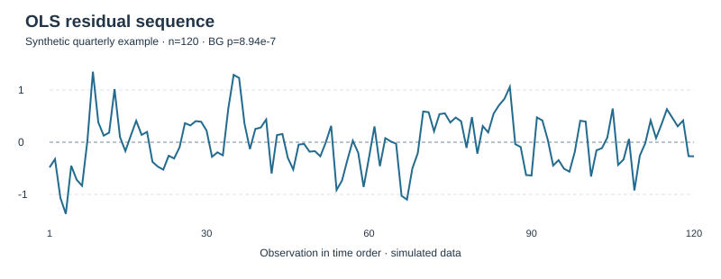
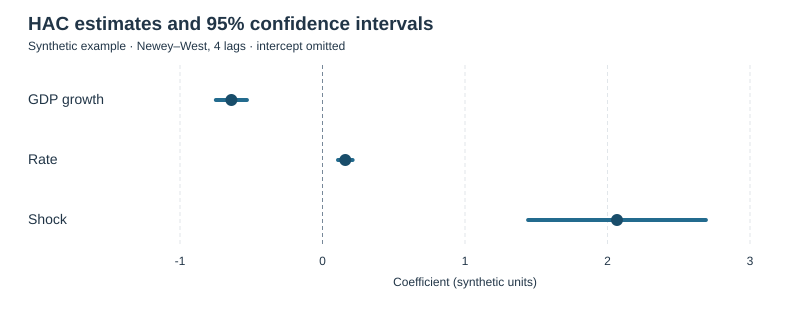

# Econometric Analysis Framework

       

**Reproducible econometric analysis | Análise econométrica reproduzível**

[English documentation](docs/README.en.md) · [Documentação em português](docs/README.pt-BR.md) · [Master prompt](PROMPT_MASTER.md) · [Demo report](results/README.md)

A portfolio project by **Matheus Silveira — Economics, Universidade Federal Fluminense (UFF)**, combining applied econometrics, Python, statistical auditing and AI-assisted workflows.

## What it does / O que faz

- Configurable OLS for numeric CSV and Excel datasets; complete-case sample, rank checks and explicit degrees of freedom.
- Diagnostic tests: Koenker Breusch–Pagan, White, Jarque–Bera, RESET, VIF and Cook's distance.
- Ordered time-series diagnostics: Durbin–Watson, Breusch–Godfrey and ADF; HAC/Newey–West inference.
- HC3 and HAC standard errors, confidence intervals and p-values alongside conventional OLS.
- CSV tables, JSON summary, regression text and SVG plots. Reusable AI prompts complement the executable workflow.

## Quick start / Início rápido

Python 3.11 or 3.12 recommended. From the repository root:

```bash
python -m venv .venv
# Windows PowerShell: .venv\Scripts\Activate.ps1
# Linux/macOS: source .venv/bin/activate
python -m pip install -r requirements.txt
python demo.py
python -m unittest discover -s tests -v
```

Use your own dataset (numeric dummy variables already encoded):

```bash
python econometrics.py data.xlsx --sheet "DADOS AGRUPADOS" --y unemployment --x gdp_growth lagged_rate shock --time date --lags 4 --out output
```

Omit `--time` for cross-sectional data. For Brazilian CSV formatting, use `--sep ";" --decimal ","`. Verify chronological spacing and all transformations before estimation.

## Demonstration / Demonstração

**Synthetic data only — not official Brazilian statistics.** Seed 42; n=120; residual df=116; R²=0.7526. The Breusch–Godfrey LM test rejects no serial correlation (p=8.94e-7); compare conventional and HAC inference. This is a reproducibility example, not a causal economic finding.





[Results, interpretation and validation](results/README.md)

## Repository map

| Path | Purpose |
| --- | --- |
| [econometrics.py](econometrics.py) | Configurable analysis CLI and Python function |
| [demo.py](demo.py) | Deterministic synthetic dataset and runnable example |
| [tests/](tests/) | Regression and input-validation checks |
| [PROMPT_MASTER.md](PROMPT_MASTER.md) | Original universal econometrics prompt (Portuguese) |
| [PROMPT_DEBUG.md](PROMPT_DEBUG.md) | Original debugging prompt |
| [docs/](docs/) | Bilingual guides |
| [examples/](examples/) | Applied model specifications |
| [results/](results/) | Executed synthetic demo evidence |

## Methodological boundaries / Limitações

HC3/HAC change covariance estimates, not OLS coefficients or residuals. They do not cure endogeneity, nonstationarity, omitted variables or misspecification. Tests are diagnostic evidence, not proof of assumptions. ADF uses an intercept and AIC-selected lags; binary variables are excluded. HAC requires meaningful equally spaced observations; verify dates and gaps manually. No automatic causal inference, panel models, IV or cointegration. The prompt covers additional tasks not all implemented by the CLI (e.g., nested-model partial F tests and Excel report export). No private data are required for the demo.

**Skills demonstrated:** Python · Data cleaning · Statistical modeling · Econometrics · Scientific computing · Reproducibility · Technical documentation · Prompt engineering.

## Author / Autor

Matheus Silveira — Economics, UFF. Academic portfolio and research methodology project.
