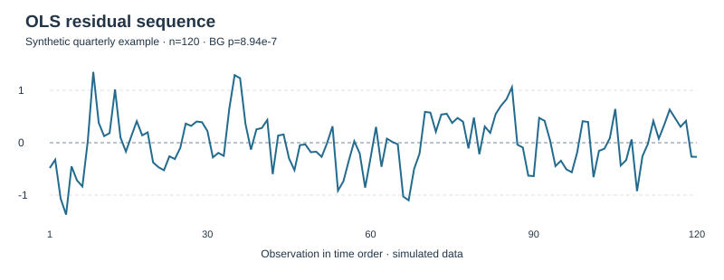
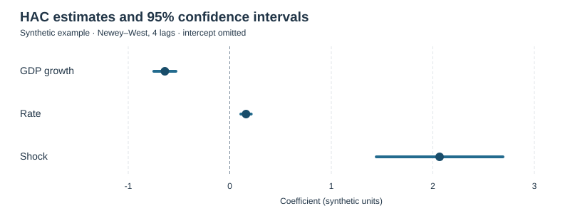

# Synthetic validation / Validação simulada

Executed locally using Python, pandas 2.2.3, NumPy 2.3.5, statsmodels 0.14.6, SciPy 1.17.0, Matplotlib 3.10.8 and openpyxl 3.1.5.

Run `python demo.py` from the root to reproduce all CSVs and five SVG figures. The example uses 120 simulated quarterly observations and seed 42. The rate regressor is a simulated stand-in for a lagged rate, not a transformation of an observed Selic series. The shock is a generic simulated dummy.

Data-generating equation: y = 9 - 0.6*g + 0.2*s + 1.5*shock + e, with serially dependent errors. No official data or causal claim.

| Metric | Result |
| --- | ---: |
| n | 120 |
| Residual df | 116 |
| R² | 0.752610 |
| Adjusted R² | 0.746212 |
| Conventional F | 117.631817 |
| Durbin–Watson | 0.962857 |

| Regressor | OLS coefficient | Classical SE | HC3 SE | HAC SE |
| --- | ---: | ---: | ---: | ---: |
| GDP growth | -0.639362 | 0.060725 | 0.063657 | 0.055028 |
| Rate | 0.160098 | 0.023719 | 0.025640 | 0.025873 |
| Shock | 2.066648 | 0.170865 | 0.230683 | 0.314941 |

| Test | p-value | Decision at 5% |
| --- | ---: | --- |
| Koenker BP | 0.231691 | Do not reject |
| White | 0.108206 | Do not reject |
| Jarque–Bera | 0.931776 | Do not reject |
| RESET | 0.611281 | Do not reject |
| Breusch–Godfrey (4 lags) | 8.94238e-7 | Reject |

The example demonstrates serial dependence and a wider HAC interval for the shock coefficient. HC3/HAC leave point estimates unchanged. Non-rejection of BP/White is not proof of constant variance. No real economic conclusion follows.

Local checks passed: expected R² and residual degrees of freedom; unchanged OLS/HAC coefficients; BG rejection; no HAC on cross-section; rank-deficient design rejected. These checks validate the illustrative run, not every possible dataset.
